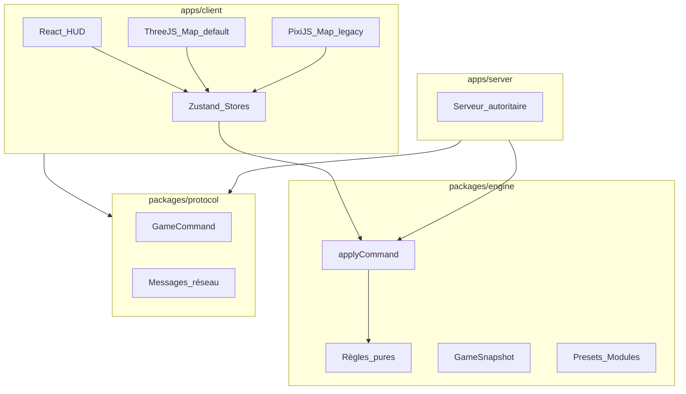

# Architecture CatanX

## Vision

CatanX vise un prototype premium desktop : partie complète locale ou réseau privé, mode classique immédiatement jouable, modules CatanX activables séparément, sauvegarde/replay fiables, interface française.

## Couches

## Moteur autoritaire

- **Indépendant** de React, Three.js, PixiJS, stockage et réseau.
- Point d'entrée : `applyCommand(state, command, context) → CommandResult`.
- **Injection** : `RandomSource`, `Clock`, `IdGenerator` — pas de `Math.random()` ni `Date.now()` dans le moteur.
- **Sortie** : nouvel état + `GameEvent[]`, ou erreur métier (`code`, `message`, `data`).

Le même moteur sert les parties locales, l'IA, les replays et le serveur réseau.

## Configuration modulaire

| Concept       | Rôle                                                                                                                |
| ------------- | ------------------------------------------------------------------------------------------------------------------- |
| `GamePreset`  | `classic`, `catanx`, `custom`, `scenario`                                                                           |
| `GameModules` | événements, technologies, armées, diplomatie, chaînes de production, conseil mondial, barbares, brouillard |
| `GameExtensionsConfig` | `citiesKnights`, `seasons`, `undergroundSky`, `pactsEmbassies` |
| `GameRules`   | taille, joueurs, objectif VP, limite de tours, ressources initiales                                                 |

Le préréglage **classic** : 19 tuiles, 3–4 joueurs, 10 VP, modules avancés désactivés.

Le préréglage **CatanX** conserve l'économie de construction et d'échange au centre, active l'extension **Saisons** et laisse les chaînes de production industrielles désactivées. Voir [SEASONS.md](SEASONS.md). Extension optionnelle **Souterrain & Ciel** : [UNDERGROUND_SKY.md](UNDERGROUND_SKY.md) (schéma 6, bonus VP composables). Extension optionnelle **Pactes & Ambassades** : [PACTS_EMBASSIES.md](PACTS_EMBASSIES.md) (schéma 7, +3 PV).

## État et persistance

- `GameSnapshot` : JSON sérialisable sans `Map` ni `Set`.
- Versionnement : `schemaVersion`, `engineVersion`, configuration, instantané, journal de commandes.
- Séparation stricte : état de jeu / état d'interface / préférences utilisateur.

## Réseau privé (Phase 6+)

- Hôte lance `apps/server` (Node.js + Socket.IO) ; bind / CORS via `CATANX_HOST` / `CATANX_CORS_ORIGIN`.
- Seul le serveur applique les commandes, lance l'aléatoire, fait jouer les IA et déclare la victoire.
- Lobby : presets / extensions, sièges IA, lien d’invitation `?mp=1&server=&room=`.
- Protocole : `room:*`, `game:*`, `command:*`, `state:*`, `player:*`, `chat:*`, `add_ai_seat` / `remove_ai_seat`.
- Guide pratique : [MULTIPLAYER.md](./MULTIPLAYER.md).

## Hors périmètre

Comptes utilisateur, matchmaking public, monétisation, modération, infrastructure cloud gérée.
